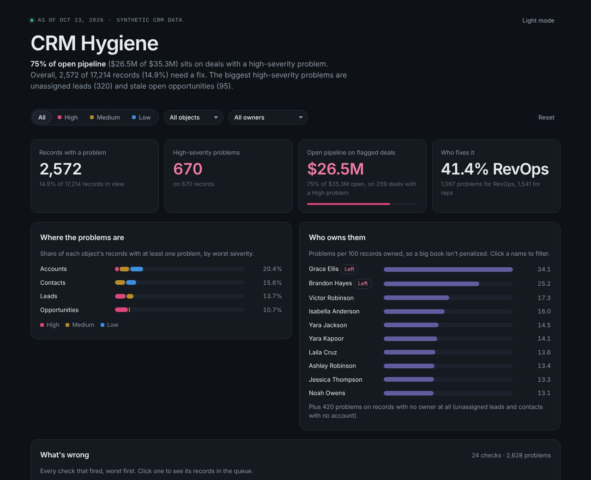
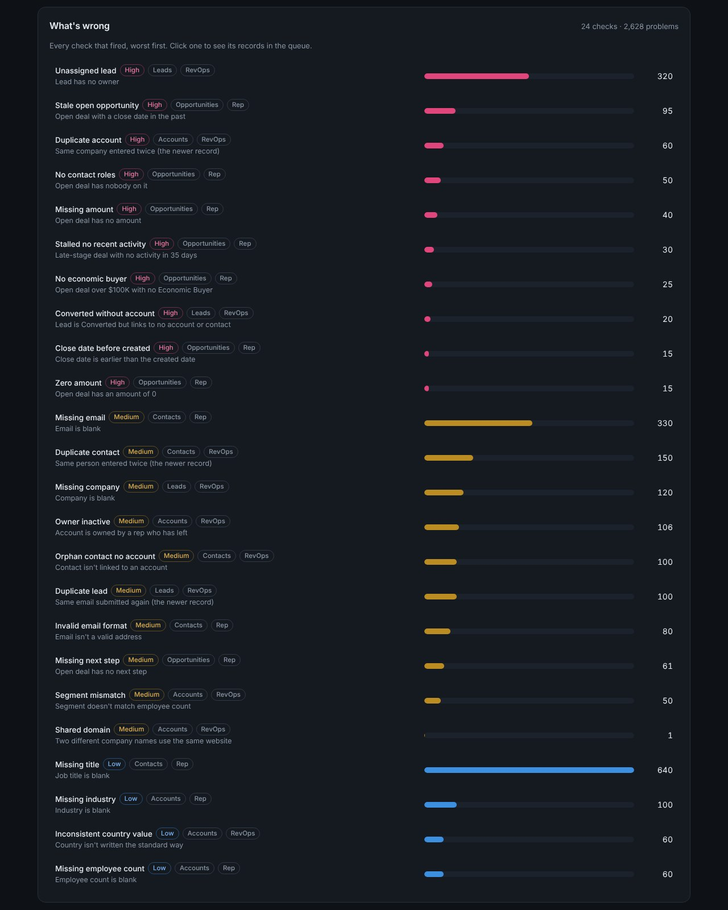

# CRM Data Hygiene

Bad CRM data costs real money. A deal with no amount skews the forecast, a lead with no owner never gets called, and a duplicate account splits one customer's history in two. This project runs 25 hygiene checks across accounts, contacts, leads and opportunities, ranks every problem by severity, and turns the results into a clean-up queue and a dashboard.

It runs on the synthetic CRM data from [gtm-synthetic-data](https://github.com/maleekduckett/gtm-synthetic-data). Every record is invented.

**[Open the live dashboard](https://maleekduckett.github.io/crm-data-hygiene/)**



## What it found

| | |
|---|---|
| Records with at least one problem | 2,572 of 17,214 (14.9%) |
| High-severity problems | 670 |
| Open pipeline on deals with a High problem | $26.5M of $35.3M (75%), on 259 of 413 open deals |
| Problems RevOps can fix without the rep | 41% |

The headline is the pipeline number. Three out of four open dollars sit on a deal with at least one High problem, most often a close date that has already passed or a big deal with no Economic Buyer. The forecast can't be trusted until those are fixed.

Two reps who have left the company still own 106 accounts. They have the highest problem rate of anyone (34 and 25 problems per 100 records), because nobody is maintaining their books.

## The checks

Severity says how much damage a problem does. "Fix by" says who usually fixes it: the rep who owns the record, or RevOps.

| Object | Check | Severity | Fix by | Found |
|---|---|---|---|---|
| Opportunities | Close date in the past on an open deal | High | Rep | 95 |
| Opportunities | Nobody on the deal (no contact roles) | High | Rep | 50 |
| Opportunities | No amount | High | Rep | 40 |
| Opportunities | Late-stage deal, no activity in 35 days | High | Rep | 30 |
| Opportunities | Deal over $100K with no Economic Buyer | High | Rep | 25 |
| Opportunities | Close date before created date | High | Rep | 15 |
| Opportunities | Amount of $0 | High | Rep | 15 |
| Opportunities | No next step | Medium | Rep | 61 |
| Accounts | Same company entered twice | High | RevOps | 60 |
| Accounts | Owner has left the company | Medium | RevOps | 106 |
| Accounts | Segment doesn't match employee count | Medium | RevOps | 50 |
| Accounts | Two different companies on one website | Medium | RevOps | 1 |
| Accounts | Country not written the standard way | Low | RevOps | 60 |
| Accounts | No industry | Low | Rep | 100 |
| Accounts | No employee count | Low | Rep | 60 |
| Leads | No owner | High | RevOps | 320 |
| Leads | Converted, but linked to no account | High | RevOps | 20 |
| Leads | Same email submitted again | Medium | RevOps | 100 |
| Leads | No company | Medium | RevOps | 120 |
| Contacts | Same person entered twice | Medium | RevOps | 150 |
| Contacts | Not linked to an account | Medium | RevOps | 100 |
| Contacts | Invalid email | Medium | Rep | 80 |
| Contacts | No email | Medium | Rep | 330 |
| Contacts | No job title | Low | Rep | 640 |

The 25th check marks the older record in each duplicate account pair, so a pair can be found from either side. It isn't counted as a problem.

### Finding duplicates

Duplicates are the hardest check to get right.

- **Leads and contacts** match on email, ignoring case. The oldest record is kept and the newer ones are flagged.
- **Accounts** match when the website name is the same (ignoring `www.` and `.com` vs `.io`) and the company name is nearly the same (ignoring case, punctuation and "Inc.", and allowing a typo).

My first version matched on website name alone and flagged 23 pairs that were really different companies, like Pinehaven and Pinehaven Home. Requiring the names to match fixed that.

One case is neither a duplicate nor clean: Amber Valley Energy and Amber Valley Cargo both use `ambervalley.io`. That gets its own check, because someone has to decide which record has the wrong website.

## Testing it

The data generator planted these problems on purpose and recorded each one in an answer key. Only `grade.py` reads the key.

| | |
|---|---|
| Planted problems found | 2,687 of 2,687 |
| Duplicates linked to the right original | 310 of 310 |
| Extra flags | 1 (the shared website above, which is a real conflict) |

A perfect score means the checks apply their rules correctly. It doesn't mean they'd catch every kind of mess in a real CRM, since the generator only planted the kinds of problems I knew to look for.

## The dashboard

The dashboard filters by severity, object and owner. Click an owner to see their book, or click a check to see its records in the clean-up queue. The queue gives each record points (High 3, Medium 2, Low 1), adds them up, and uses open deal size to break ties, so the records worth fixing first are at the top.

It's one self-contained HTML file (`docs/index.html`) with the data built in. `build_dashboard.py` writes it from the check results and the SQL report.



## What the files do

| File | Job |
|---|---|
| `common.py` | The rule book: every check's object, severity and owner, plus thresholds |
| `run_checks.py` | Runs the checks. Writes `results/issues.csv`, one row per problem |
| `grade.py` | Compares the results to the answer key. The only file that reads it |
| `report.py`, `sql/report.sql` | Summary tables in SQL: clean rate by object, problems by check and owner, pipeline at risk, the queue |
| `build_dashboard.py`, `dashboard/template.html` | Builds the dashboard |
| `tests/test_rules.py` | Checks the matching rules (duplicates, emails, segments) |

## Run it

```bash
git clone https://github.com/maleekduckett/gtm-synthetic-data   # next to this repo
pip install -r requirements.txt
python run_checks.py
python grade.py
python report.py
python build_dashboard.py
python tests/test_rules.py
```

Use `--data-dir` if the data is somewhere else.

## Limits

- The data is a snapshot as of Oct 13, 2026. "Stale" and "no recent activity" are measured from that date.
- The thresholds (35 days without activity, $100K for an Economic Buyer) are my judgment. A real team would set them with sales leadership.
- Duplicate matching only compares records that share a website name. Two records for one company with totally different websites wouldn't be caught.
- The checks find problems. They don't fix them. On a real CRM the next step would be merge rules for duplicates and assignment rules for unowned records.
